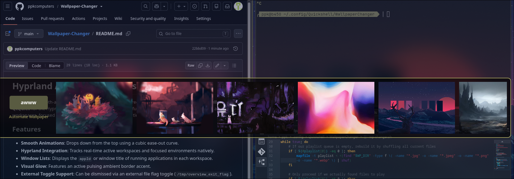

# Quickshell Wallpaper Changer OSD

An interactive On-Screen Display (OSD) and automation framework built using **Quickshell (QML)**, **Bash**, and the **awww** wallpaper daemon. It provides a fluid graphical drawer to select and apply wallpapers on the fly or toggle an automated background rotation loop driven by targeted **systemd user timers**.

This tool changes the desktop wallpaper across all Arch-based distributions. In addition, it updates the Brave browser wallpaper and the wallpaper on Android phones.

---

```bash
curl -sSf https://raw.githubusercontent.com/ppkcomputers/Wallpaper-Changer/main/install.sh | bash
```

---



## Repository File Structure

### `state.conf`
A simple key-value flat file configuration used to maintain persistent state across desktop reboots. It tracks whether the wallpaper rotation loop is currently running and caches the absolute path of the active wallpaper.

* **`AUTOMATE`**: A boolean flag (`true`/`false`) determining if the systemd timer should be active.
* **`LAST_WP`**: The absolute file path to the last successfully applied image.

### `toggle.sh`
The primary operational entry point for window manager execution. This script checks if the Quickshell graphical interface is currently running. If it is active, it kills the process to hide the interface; if it is missing, it spins up Quickshell with the wallpaper QML blueprint running in the background.

### `wallpaper-gui.qml`
The **Quickshell** graphical layer framework. It renders a modern, animated slide-out panel containing:

* A directory parser that scans your wallpaper folder dynamically for valid image types (`.jpg`, `.png`, `.webp`, etc.).
* A status header with a toggle switch to safely transition the systemd background automation routine.
* A horizontal list model showing dynamic, asynchronous cached thumbnails of available images that apply instantly via a mouse click.

### `wp-changer.sh`
The central backend engine managing image application, systemd unit provisioning, and randomized state logic.

* Handles safe `--boot` state restoration without stalling performance.
* Generates and monitors local runtime systemd service configurations (`wp-automate.service` and `wp-automate.timer`) dynamically.
* Interacts directly with the local socket pipelines of the `/usr/bin/awww` wallpaper daemon for transitions.
* Applies the selected wallpaper to the desktop (all Arch-based distributions), Brave browser, and Android phone.

---

## Hyprland Integration

To open and close the Wallpaper Changer dashboard instantly using your Lua-based Hyprland configuration, map the execution of `toggle.sh` to your preferred key binding:

```lua
-- Toggle the Quickshell Wallpaper Changer OSD
hl.bind("$mainMod", "W", "exec", os.getenv("HOME") .. "/.config/Quickshell/WallpaperChanger/toggle.sh")
```
